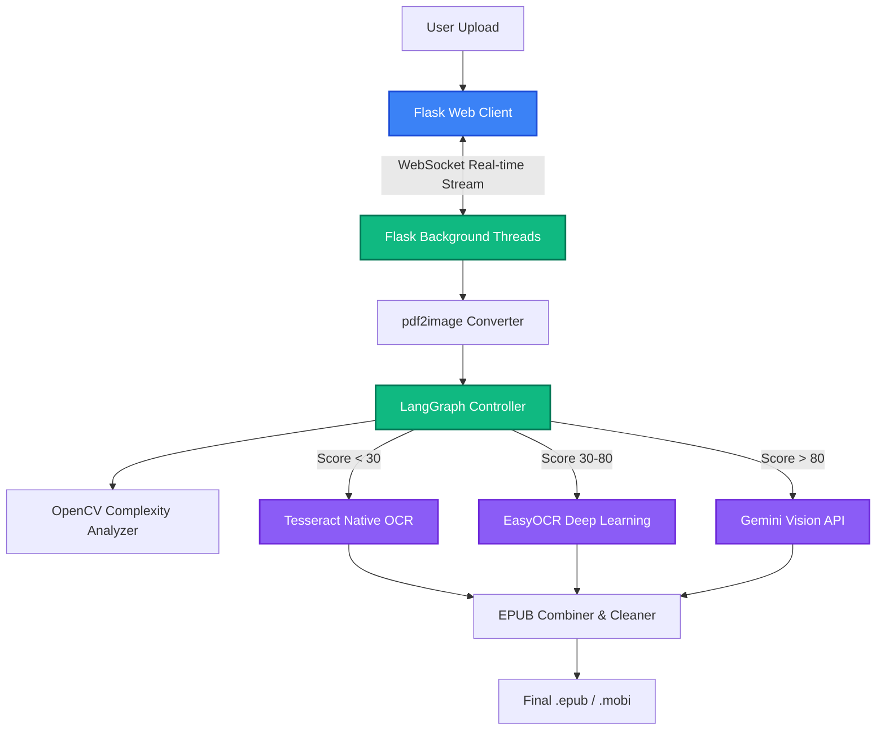

# Enhanced Telugu & English OCR - Developer Guide

This document serves as the comprehensive and authoritative guide to the Enhanced Telugu & English OCR Converter project. It outlines the complete system architecture, the integration of advanced tools like LangGraph and Google Gemini Vision, and step-by-step installation instructions for deployment on local or WSL environments.

---

## 🚀 1. Project Overview & Features

This application specializes in converting high-complexity, scanned Telugu and English PDF documents into structured, reflowable EPUB and MOBI formats. 

Unlike traditional flat OCR tools, this system acts as an "intelligent pipeline", dynamically processing individual pages using the best tool for the job.

### Core Capabilities:
- **Intelligent Page Routing**: A LangGraph state machine orchestrates whether a page should be processed by simple Tesseract, table-heavy EasyOCR, or the premium Gemini AI based on deep image analysis.
- **Bilingual Support**: Natively optimized for Telugu (`tel`) including complex *Vatulu* (subscript consonants) and *Guninthalu* (vowel modifiers), with seamless English side-by-side detection.
- **Computer Vision Layout Analysis**: OpenCV evaluates edge density, identifies columns, isolates tables, and detects illustrations.
- **Image Preservation**: Intelligently crops and preserves actual illustrations from complex PDFs, embedding them back into the final EPUB to retain context.
- **Live Complexity UI Dashboard**: A real-time, WebSocket-powered web dashboard visualizes the ongoing conversion metrics, displaying precise engine decisions and performance timings per page.

---

## 🏗️ 2. System Architecture

The project follows a standard modern web architecture split across a Flask backend, a dynamic JS frontend, and heavy-duty computer vision processing queues.

### Component Relationship Diagram


---

## 🧠 3. Step-by-Step Logical Flow

When a PDF document is uploaded to the system via the `http://localhost:5001` UI, here is the granular sequence of computational events:

### Phase 1: Preparation
1. The Flask server (`app.py`) accepts the file and assigns a unique tracking UUID.
2. The user's specific processing parameters (e.g., Image Preservation toggle) are bundled.
3. The background thread spins up and begins broadcasting `"Initializing..."` back to the live UI dashboard via SocketIO.

### Phase 2: Breakdown & Analysis
1. The PDF is sliced into high-resolution JPG memory objects using `pdf2image`.
2. For each individual page, `page_complexity_analyzer.py` calculates a structured schema:
    - **Edge Analysis**: Grayscale variance and Canny edge detection find noise limits.
    - **Component Hierarchy**: The script detects multiple bounding regions to deduce single vs. multi-column layouts.
    - **Illustration Isolation**: Image content is separated from text content using contour approximations.
    - **Scoring**: A final `0 to 100` numeric complexity score is assigned. 

### Phase 3: LangGraph Pipeline Orchestrator
1. `langchain_ocr_pipeline.py` receives the page image and its numeric score.
2. **Routing Function**: 
    - Very simple pages route directly to lightning-fast Tesseract OCR.
    - Medium complexity pages (like structured grids or tables) route to EasyOCR which naturally respects spatial positioning better.
    - Highly degraded scans or extremely complex geometric pages route directly to `gemini-2.5-flash-8b` via structured system prompts aiming for strict literal extraction.
3. **The Fallback Chain**: If any single engine fails to find reasonable text (returns junk characters), LangGraph automatically cascades down to the next fallback engine until success is achieved.
4. *SocketIO Intercept*: At the moment the engine finishes its extraction, a JSON payload summarizing the exact complexity metrics of the page is pushed to the UI, instantly rendering a new row on the user's dashboard!

### Phase 4: Finalization
1. Raw text bodies are scrubbed of artifacts (e.g., standardizing repeating PDF footers or page numbers).
2. Spliced illustrations from Phase 2 are encoded into the HTML body.
3. `ebooklib` iterates through all chapters and constructs standard `.epub` zip structure.
4. If MOBI formatting was requested, Calibre's CLI hooks transform the packaged zip.
5. The UI stream completes and the download button emerges for the user.

---

## 📂 4. Core Directory Structure

The repository is modularly structured, splitting OCR engines into a strict OOP factory pattern for effortless future upgrades:

```bash
📦 Latest_OCR
 ┣ 📂 scripts
 ┃ ┣ 📜 start.sh          # Primary bash launch script (Linux/Mac)
 ┃ ┗ 📜 start.bat         # Primary batch launch script (Windows)
 ┣ 📂 src
 ┃ ┣ 📂 static
 ┃ ┃ ┣ 📂 css             # Animated gradient themes & UI Dashboard styles
 ┃ ┃ ┗ 📂 js              # WebSocket listeners & Dropzone controllers
 ┃ ┣ 📂 templates
 ┃ ┃ ┗ 📜 index.html      # Primary Flask presentation layer
 ┃ ┣ 📜 app.py            # Head Flask server
 ┃ ┣ 📜 config.py         # Global limits, keys, models, and thresholds
 ┃ ┣ 📜 gemini_ocr_processor.py      # Google Vision API Handler
 ┃ ┣ 📜 langchain_ocr_pipeline.py    # LangGraph Routing Nodes
 ┃ ┣ 📜 mobi_converter.py            # Calibre Interfacer
 ┃ ┣ 📜 ocr_factory.py               # Singleton / Class factory
 ┃ ┣ 📜 page_complexity_analyzer.py  # Computer Vision Operations
 ┃ ┗ 📜 pdf_to_epub_converter_optimized_v2.py # Master Conversion Loop
 ┣ 📜 requirements.txt    # Python PIP manifest
 ┣ 📜 .env                # Secret keys (ignored by git)
 ┗ 📜 SETUP_GUIDE.md      # Mini installation reference
```

---

## 🛠️ 5. Setting up the Development Environment

### Prerequisites
* **Python 3.10+**
* **Ubuntu / WSL (Recommended)** - For maximum native performance with Tesseract. Windows setups are also completely supported.

### System Dependancies (Linux/WSL)
You must install the baseline Tesseract engines natively on your OS before pip installing to Python:
```bash
sudo apt update
sudo apt install tesseract-ocr
sudo apt install tesseract-ocr-tel
sudo apt install tesseract-ocr-eng
sudo apt install poppler-utils  # Required for converting PDFs to Images
sudo apt install calibre        # Required for MOBI output (optional)
```

### Python Installation
Initialize the virtual environment:
```bash
python3 -m venv venv
source venv/bin/activate
pip install --upgrade pip
pip install -r requirements.txt
```

### Authentication & Keys
To utilize the absolute maximum potential of the pipeline (Gemini Extreme Routing), you must place an active API key in the root environment cache.
1. Create a `.env` file in the project's absolutely root directory next to `requirements.txt`.
2. Add your Google Key:
```text
GEMINI_API_KEY="your_ai_studio_api_key_here"
```

### Serving
Run the fully automated launch script. This will verify dependencies, boot the Flask web, and listen tightly on `0.0.0.0` for incoming data.
```bash
# On Linux / WSL
chmod +x scripts/start.sh
./scripts/start.sh

# On Windows Native
scripts\start.bat
```

*Your interface will be highly available at: `http://localhost:5001`*
